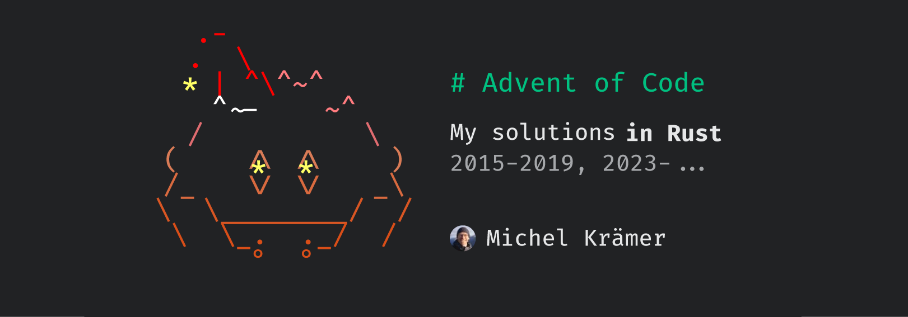
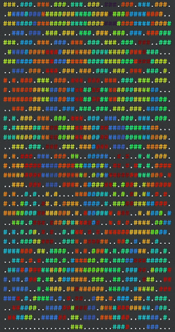
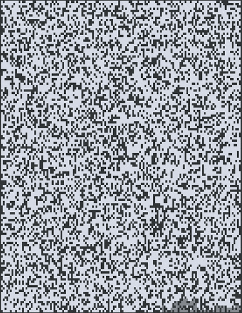
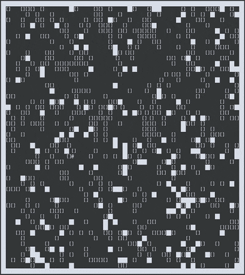
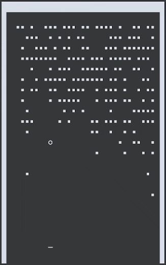
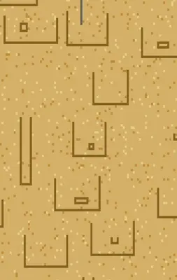
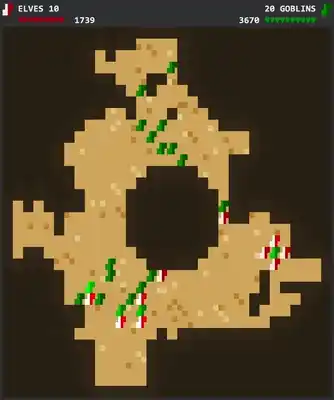
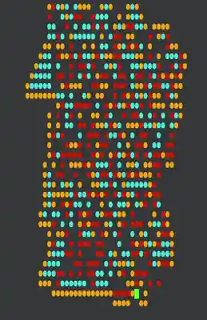
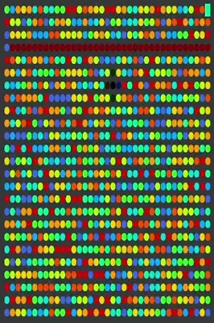
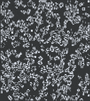

<div align="center">
	
	<br>
  <br>
</div>

> These are my solutions to the annual [Advent of Code](https://adventofcode.com)
challenge.

## Goals

- *No AI. Every line in this repository was written by hand.* It's not that I'm against using AI for software development (in fact, I use it heavily for my work), but in my opinion, Advent of Code is about solving problems, and it's no fun if you let some machine solve those problems for you.
- *Implement everything in Rust.* Because I love it!
- *Find generalized solutions that work with every input.*
- *Avoid 3rd party dependencies* (if possible and reasonable). Exceptions are [rustc-hash](https://github.com/rust-lang/rustc-hash) (because it's just too fast), [rayon](https://github.com/rayon-rs/rayon) for parallelization (only in rare cases!), and any crate necessary to do occasional [terminal visualizations](#terminal-visualizations).
- *Try to optimize performance* (to the best of my knowledge, if it doesn't conflict with the other goals, and if it doesn't obscure the solution too much).
- *Find clever solutions to complex problems that others might not have found.* Some highlights I'm particularly proud of:
  - [Day 10 of 2025](2025/day10/src/main.rs): While most people approached this problem using a solver (such as [S3](https://github.com/Z3Prover/z3) or [good_lp](https://github.com/rust-or/good_lp)), I found a solution that works completely without a 3rd party dependency. I implemented a DFS in which I use heuristics to prune as many branches as possible. This is definitely not the fastest approach possible, but it gets the job done in reasonable time and is certainly quite unique. See my [Reddit comment](https://www.reddit.com/r/adventofcode/comments/1pity70/comment/ntb36sb/) for more information.
  - [Day 25 of 2023](2023/day25/src/main.rs): Using [Brandes' algorithm](https://doi.org/10.1080/0022250X.2001.9990249) to quickly calculate the betweenness centrality of graph nodes.
  - [Day 21 of 2023](2023/day21/src/main.rs): Applying [bit operations](2023/day21/src/bitarray.rs) to simulate the cellular automaton, which allowed me to implement a fast and generalized solution that should work on any input (unlike most other approaches).
  - [Day 25 of 2018](2018/day25/src/main.rs): Combining DBSCAN with a spatial index based on Morton indices. Very fast and scalable!
  - [Day 25 of 2017](2017/day25/src/main.rs): Fast Turing machine simulation using memoized macro transitions over fixed-size blocks inspired by tape compression and the [linear speedup theorem](https://en.wikipedia.org/wiki/Linear_speedup_theorem).

## Terminal visualizations

I've created terminal visualizations of some puzzles for fun:

<table>
  <tr>
    <td align="center">
      <a href="2025/day12/aoc_2025_day12.gif"></a><br />
      <a href="2025/day12/src/main.rs">2025 - Day 12:<br>Christmas Tree Farm</a>
    </td>
    <td align="center">
      <a href="2025/day04/aoc_2025_day04.gif"></a><br />
      <a href="2025/day04/src/main.rs">2025 - Day 4:<br>Printing Department</a>
    </td>
    <td align="center">
      <a href="2024/day15/aoc_2024_day15.gif"></a><br />
      <a href="2024/day15/src/main.rs">2024 - Day 15:<br>Warehouse Woes</a>
    </td>
  </tr>
  <tr>
    <td align="center">
      <a href="2019/day13/aoc_2019_day13.gif"></a><br />
      <a href="2019/day13/src/main.rs">2019 - Day 13:<br>Care Package</a>
    </td>
    <td align="center">
      <a href="2018/day18/aoc_2018_day18.webp"></a><br />
      <a href="2018/day18/src/main.rs">2018 - Day 18:<br>Settlers of The North Pole</a>
    </td>
    <td align="center">
      <a href="2018/day17/aoc_2018_day17.webp"></a><br />
      <a href="2018/day17/src/main.rs">2018 - Day 17:<br>Reservoir Research</a>
    </td>
  </tr>
  <tr>
    <td align="center">
      <a href="2018/day15/aoc_2018_day15.webp"></a><br />
      <a href="2018/day15/src/main.rs">2018 - Day 15:<br>Beverage Bandits</a>
    </td>
    <td align="center">
      <a href="2017/day22/aoc_2017_day22.webp"></a><br />
      <a href="2017/day22/src/main.rs">2017 - Day 22:<br>Sporifica Virus</a>
    </td>
    <td align="center">
      <a href="2016/day22/aoc_2016_day22.gif"></a><br />
      <a href="2016/day22/src/main.rs">2016 - Day 22:<br>Grid Computing</a>
    </td>
  </tr>
  <tr>
    <td align="center">
      <a href="2016/day08/aoc_2016_day08_mini.gif"></a><br />
      <a href="2016/day08/src/main.rs">2016 - Day 8:<br>Two-Factor Authentication</a>
    </td>
    <td align="center">
      <a href="2015/day18/aoc_2015_day18.gif"></a><br />
      <a href="2015/day18/src/main.rs">2015 - Day 18:<br>Like a GIF For Your Yard</a>
    </td>
  </tr>
</table>

If you want to visualize your own input with my code, just change into the solution's directory (e.g. `cd 2025/day12`) and run the following command:

```bash
cargo run --release --features=visualize
```

## License

The solutions are released under the **MIT license**. See the
[LICENSE](LICENSE) file for more information.
